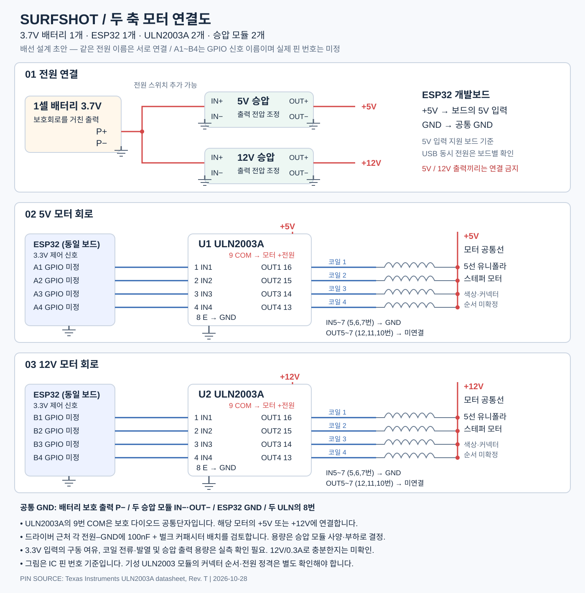

# Surfshot

스마트폰을 장착한 YT-2000 팬틸트 헤드로 GNSS 태그 착용자를 자동 촬영하는 프로젝트입니다.

**현재 단계: 하드웨어 배선 초안 및 기술 구상. 실제 조립·동작 검증 전입니다.**  
정리일: 2026-10-28

## KiCad 편집용 회로도

[KiCad 프로젝트와 연결 설명](hardware/kicad/)을 추가했습니다. `Surfshot.kicad_pro`를 열면 됩니다. KiCad 10.0.5 ERC 오류·경고 0건이며, 실제 GPIO·모터 하네스와 전원 용량 확인은 남아 있습니다.

## 모터 연결도

[회로도 원본 SVG](docs/hardware/surfshot-motor-wiring.svg)

그림에 두 번 표시된 ESP32는 **동일한 보드 1개**입니다. A1~A4와 B1~B4는 논리적인 제어 신호 이름이며, 실제 GPIO 번호가 아닙니다.

## 목표와 전체 구성

- 기존 YT-2000 기구·기어·모터를 활용하고 스마트폰을 장착합니다.
- ESP32가 별도 모터 드라이버를 통해 팬·틸트 두 축을 제어합니다.
- 착용 태그의 GNSS 위치를 LoRa로 PTZ 측에 전달합니다.
- 폰이 인터넷/NTRIP에서 RTCM을 받아 PTZ 중계기 → LoRa → 태그의 RTK 수신기로 전달하는 구상입니다. 태그는 위치·측정 시각·측위 품질을 회신합니다.
- 스마트폰은 촬영·녹화·줌, 영상 추적, IMU 처리를 담당합니다.
- 우선 약 **100m**에서 검증합니다. 장기 목표 500m의 통신·영상·추적 성능은 검증되지 않았습니다.

## 하드웨어 계획

| 구성품 | 수량 | 현재 기준 |
|---|---:|---|
| ESP32 개발보드 | 1 | 정확한 모델과 GPIO 배정 미정. 5V 입력 지원 여부 확인 |
| ULN2003A | 2 | 모터당 1개, 각 4채널 사용 |
| 5V 승압 모듈 | 1 | 5V 모터 및 ESP32 개발보드 전원 |
| 12V 승압 모듈 | 1 | 12V 모터 전원 |
| 1셀 3.7V 배터리 | 1 | 보호회로·허용 전류 확인 필요 |
| 기존 5선 모터 | 2 | 각 모터의 공통선·코일 순서 확인 필요 |

기존 사진 판독 기록상 한 모터는 **35BYJ46, 5V, 감속비 1/30**, 다른 모터는 **12V**입니다. 12V 모터의 전체 모델명과 두 모터의 코일 저항·정격전류는 미확인입니다. 모터 선 개수는 5개로 확인한 기록이 있습니다. 실제 배선 전 라벨과 측정값을 대조해야 합니다.

## 연결 기준

두 승압 모듈의 입력은 보호회로를 거친 배터리 출력에 병렬로 연결합니다. **5V와 12V 출력은 서로 연결하지 않습니다.**

각 ULN2003A의 연결은 다음과 같습니다.

| ULN2003A IC 핀 | 연결 |
|---|---|
| 1, 2, 3, 4 (IN1~4) | ESP32의 서로 다른 GPIO 4개 |
| 16, 15, 14, 13 (OUT1~4) | 해당 모터의 코일선 4개 |
| 9 (COM) | 해당 모터의 +전원: 5V 또는 12V |
| 8 (E) | 공통 GND |
| 5, 6, 7 (미사용 입력) | GND |
| 12, 11, 10 (미사용 출력) | 미연결 |

- 모터 **공통선도 해당 모터의 +전원**에 연결합니다.
- 배터리 보호 출력 P−, 두 승압 모듈 IN−·OUT−, ESP32 GND, 두 ULN2003A의 8번은 공통 접지입니다. 비절연 승압 모듈 기준입니다.
- 9번 COM은 역기전력 보호 다이오드 공통단자입니다.
- 핀 번호는 IC 기준입니다. 기성 ULN2003 모듈의 커넥터 순서·전원 정격·내부 연결은 별도 확인합니다.
- 드라이버 가까이 전원–GND 사이 디커플링과 벌크 커패시터를 배치합니다. 도면의 100nF는 검토 시작값이며, 최종 용량은 승압 모듈의 출력 커패시터 조건과 부하 응답에 맞춥니다.
- ESP32 GPIO에는 모터 전압을 연결하지 않습니다. 개발보드 5V 입력과 USB를 동시에 사용할 수 있는지는 보드 회로로 확인합니다.

핀 기준: [TI ULN2003A 데이터시트, Rev. T](https://www.ti.com/lit/gpn/ULN2003A).

## 아직 확인해야 할 사항

1. **전원 용량:** 검토했던 승압 모듈의 판매 표기는 3.7V 입력에서 5V/1A, 12V/0.3A입니다. 실제 두 모터 및 ESP32 부하에 충분하다는 결론은 내리지 않았습니다.
2. **모터 배선:** 전원을 분리하고 공통선과 코일선 사이 저항을 측정합니다. 실제 커넥터 순서·선 색상·구동 순서는 아직 미정입니다.
3. **구동 여유:** ESP32의 3.3V 출력으로 해당 코일 전류를 구동할 때 ULN2003A 입력 조건, 전압 강하, 발열, 토크를 확인합니다. 단일 채널 최대 정격을 여러 채널의 동시 허용 전류로 간주하지 않습니다.
4. **배터리:** 배터리·보호회로의 연속/순간 허용 전류와 충전 회로 구성을 확인합니다.
5. **기구:** 팬·틸트와 5V·12V 모터의 대응, 회전 한계, 리미트 센서, 기어 유격, 탈조 및 저속 움직임을 확인합니다.

별도 보드에 있는 **ULN2002 마킹의 10핀 IC**는 정확한 제조사·데이터시트·핀맵이 미확인입니다. 이 회로도의 16핀 ULN2003A와 혼동하지 않습니다.

## 추적 소프트웨어 방향

- 사용 중인 GNSS는 LC29H이며, 정확한 세부 모델과 실제 측위 갱신율은 확인해야 합니다. LG290P로 교체하기로 결정한 상태는 아닙니다.
- GNSS로 PTZ→태그의 상대 위치·방위·거리를 계산하고 영상으로 화면 위치를 보정합니다. PTZ 설치 위치를 어떻게 확보할지도 미정입니다.
- 영상과 GNSS를 함께 사용해 **카메라 절대 방위 기준을 지속 보정**하는 것이 목표입니다.
- 개념식: 카메라 절대 방위각 ≈ GNSS로 계산한 태그 방위각 − 영상 속 대상의 중심 대비 수평각. 부호·좌표계·렌즈 보정은 구현 시 정의합니다.
- 폰 IMU로 빠른 회전을 추정하고 영상·GNSS로 누적 오차를 보정합니다. 영상/GNSS 시간 정렬, 줌별 화각, 동일 대상 식별과 품질별 보정 강도가 필요합니다.
- 수동 초기 정렬을 줄이기 위해 넓은 화각에서 자동 탐색 → 대상 확인 → 방향 기준 보정 → 추적·줌을 검토합니다.
- RTK FIX 여부만으로 추적을 중단하지 않고 품질 저하·위치 튐·통신 단절에 맞춰 동작과 줌을 조정합니다.
- 폰 기종/OS, ESP32 모델, LoRa 모듈·주파수·안테나, 통신 프로토콜은 미정입니다.

## 집에서 이어갈 순서

1. 사용할 ESP32 보드, 승압 모듈, ULN2003 모듈 모델을 확인합니다.
2. 두 모터의 코일 저항과 커넥터 배선을 측정해 이 문서에 기록합니다.
3. GPIO와 실제 핀맵을 확정하고 전원 용량을 계산합니다.
4. 한 축씩 저속으로 구동한 뒤 두 축 동시 동작·전류·발열을 확인합니다.
5. 폰에서 방향·속도·정지 명령을 보내는 기능과 통신 단절 시 정지를 구현합니다.
6. GNSS 위치 전송 및 RTCM 중계를 검증하고, 실제 착용 상태에서 100m 시험을 진행합니다.
7. 영상 보정·IMU·줌을 통합합니다.

## 참고 자료

- [SOLOSHOT 세션 로그 분석](https://github.com/maiermic/soloshot-session-to-gpx-converter)
- [SOLOSHOT 관련 공개 토론](https://github.com/maiermic/robot-cameraman/issues/30)
- [YT-1000 ESP32 개조](https://github.com/lasthead/zifon-yt1000-ptz-camera-control)
- [YT-1000 회로·통신 분석](https://github.com/featherbear/zifon-yt1000-wifi-acu)

YT-1000 자료와 현재 YT-2000의 호환성은 확인되지 않았습니다. 참고 제품의 통신 방식이나 부품을 이 프로젝트의 확정 사양으로 간주하지 않습니다.
